## 5.2. Landing Page, Services & Applications Implementation
 
En esta sección se explica y evidencia el proceso de implementación, pruebas, documentación y despliegue del Landing Page, los Web Services y la Frontend Web Application de Trazza, organizado por Sprint. En el Sprint 1 el equipo implementó y desplegó la primera versión del Landing Page. En el Sprint 2 se publicó una nueva versión del Landing Page y se planificó la primera versión de la Web Application a partir de los diseños de la sección 4.4. En el Sprint 3 se implementaron los Web Services en Java con Spring Boot, se integró la Web Application con ellos y se desplegaron todos los productos en AWS.
 
### 5.2.1. Sprint 1
 
En esta sección se registra el avance en producto y en trabajo colaborativo del Sprint 1, cuyo alcance fue la primera versión del Landing Page, primer punto de contacto de Trazza con transportistas y comerciantes MYPE.
 
#### 5.2.1.1. Sprint Planning 1
 
En el Sprint Planning 1 el equipo definió el objetivo del Sprint y seleccionó las User Stories del Landing Page con mayor prioridad en el Product Backlog.
 
| Sprint # | Sprint 1 |
| :--- | :--- |
| **Sprint Planning Background** | |
| Date | 2026-09-18 |
| Time | 10:00 AM |
| Location | Reunión virtual vía Microsoft Teams |
| Prepared By | Peñaranda Caldas, Gabriel Augusto |
| Attendees (to planning meeting) | Checalla Apaza, Emanuel Renato / Lozano Quispe, Fabricio Jofred / Pezo Castilla, Maria Jose / Peñaranda Caldas, Gabriel Augusto / Vite Celis, Rodrigo Matias |
| Sprint 0 Review Summary | N/A. Es el primer Sprint del proyecto. |
| Sprint 0 Retrospective Summary | N/A. Es el primer Sprint del proyecto. |
| **Sprint Goal & User Stories** | |
| Sprint 1 Goal | **Nuestro enfoque está en** publicar la primera versión del Landing Page de Trazza, que presente la propuesta de valor para transportistas con viajes de retorno vacíos y para comerciantes MYPE que necesitan enviar mercadería por Lima. **Creemos que esto entrega** una primera razón clara para registrarse **a** transportistas independientes y comerciantes MYPE de Lima. **Esto se confirmará cuando** un visitante pueda abrir el Landing Page desde una URL pública, identificar la propuesta para su segmento, leer los testimonios y llegar al formulario de registro de su rol. |
| Sprint 1 Velocity | 5 Story Points |
| Sum of Story Points | 5 Story Points (US04: 2, US05: 2, US25: 1) |
 
#### 5.2.1.2. Aspect Leaders and Collaborators
 
Los aspectos del Sprint 1 son la implementación del Landing Page, el diseño de sus wireframes y mock-ups (sección 4.3) y su despliegue. Los líderes se asignaron según la participación registrada en los repositorios.
 
| Team Member (Last Name, First Name) | GitHub Username | Landing Page Implementation (L/C) | Landing Page UI Design (L/C) | Landing Page Deployment (L/C) |
| :--- | :--- | :---: | :---: | :---: |
| Checalla Apaza, Emanuel Renato | Emanuelca135 | C | C | L |
| Lozano Quispe, Fabricio Jofred | FabricioZz15 | C | L | C |
| Pezo Castilla, Maria Jose | MariaJosePezo | C | L | C |
| Peñaranda Caldas, Gabriel Augusto | gapc2124 | L | C | C |
| Vite Celis, Rodrigo Matias | rodriznnn | C | C | C |
 
#### 5.2.1.3. Sprint Backlog 1
 
El objetivo del Sprint 1 fue publicar la primera versión del Landing Page. Las User Stories se descompusieron en tareas de 4 a 8 horas.
 
 
**URL público del Board:** [https://trazza.atlassian.net/jira/software/projects/SCRUM/boards/1/backlog](https://trazza.atlassian.net/jira/software/projects/SCRUM/boards/1/backlog)
 
| Sprint # | Sprint 1 | | | | | | |
| :--- | :--- | :--- | :--- | :--- | :--- | :--- | :--- |
| **User Story** | | **Work-Item / Task** | | | | | |
| **Id** | **Title** | **Id** | **Title** | **Description** | **Estimation (Hours)** | **Assigned To** | **Status** |
| US04 | Landing Page: Propuesta para Transportistas | T01 | Estructura base del repositorio | Crear el repositorio `Trazza-landingPage` y la estructura inicial del sitio. | 4 | Pezo Castilla, Maria Jose | Done |
| US04 | Landing Page: Propuesta para Transportistas | T02 | Header, navegación y Hero | Implementar la barra de navegación responsive y la sección Hero con los botones por rol. | 6 | Peñaranda Caldas, Gabriel Augusto | Done |
| US04 | Landing Page: Propuesta para Transportistas | T03 | Sección para transportistas | Maquetar los beneficios para el transportista y el llamado a registrarse. | 4 | Peñaranda Caldas, Gabriel Augusto | Done |
| US05 | Landing Page: Propuesta para Emprendedores | T04 | Sección para comerciantes y comparativa | Maquetar los beneficios para el comerciante MYPE y la comparativa frente al flete tradicional. | 5 | Peñaranda Caldas, Gabriel Augusto | Done |
| US25 | Landing Page: Testimonios de Éxito | T05 | Testimonios y footer | Implementar las tarjetas de testimonios, la sección de contacto y el footer. | 4 | Peñaranda Caldas, Gabriel Augusto | Done |
| — | Constraint: despliegue | T06 | Despliegue en AWS Amplify | Conectar el repositorio con AWS Amplify, publicar la rama `main` y validar la URL pública. | 4 | Checalla Apaza, Emanuel Renato | Done |
 
#### 5.2.1.4. Development Evidence for Sprint Review
 
En el Sprint 1 se creó el repositorio del Landing Page y se implementó su primera versión, que luego se publicó en AWS Amplify. En paralelo se documentaron en el informe el diseño del Landing Page y la configuración del proyecto. La siguiente tabla muestra los commits relacionados con la implementación.
 
| Repository | Branch | Commit Id | Commit Message | Commit Message Body | Committed on (Date) |
| :--- | :--- | :--- | :--- | :--- | :--- |
| NexusLibre-1ASI0729-2620-16692/Trazza-landingPage | main | f5ef775 | first commit | - | 2026-09-11 |
| NexusLibre-1ASI0729-2620-16692/Trazza-landingPage | main | 27773c4 | feat: creando nuevo repositorio debido a los errores del anterior | - | 2026-09-18 |
| NexusLibre-1ASI0729-2620-16692/Trazza-report | feature/43-landing-page-ui-design | 11323a7 | docs(landing): add landing wireframes images | - | 2026-09-18 |
| NexusLibre-1ASI0729-2620-16692/Trazza-report | feature/43-landing-page-ui-design | be862b6 | docs(landing): add landing mock ups desk images | - | 2026-09-18 |
| NexusLibre-1ASI0729-2620-16692/Trazza-report | feature/43-landing-page-ui-design | a05df02 | docs(chapter4): add landing page ui design desktop wireframes and mockups descriptions | - | 2026-09-18 |
| NexusLibre-1ASI0729-2620-16692/Trazza-report | feature/51-software-configuration-management | 78675b9 | doc(5.1): add complete content for software configuration management | - | 2026-09-18 |
| NexusLibre-1ASI0729-2620-16692/Trazza-report | feature/52-landing-page-services-applications-implementation | 84eb2d8 | doc(5.2): populate sprint 1 implementation and evidence sections | - | 2026-09-18 |
 
#### 5.2.1.5. Execution Evidence for Sprint Review
 
Al cierre del Sprint 1, el Landing Page quedó publicado en una URL pública. Presentaba la propuesta de valor para ambos segmentos, la comparativa frente al flete tradicional, los testimonios y los accesos al registro por rol.
 

  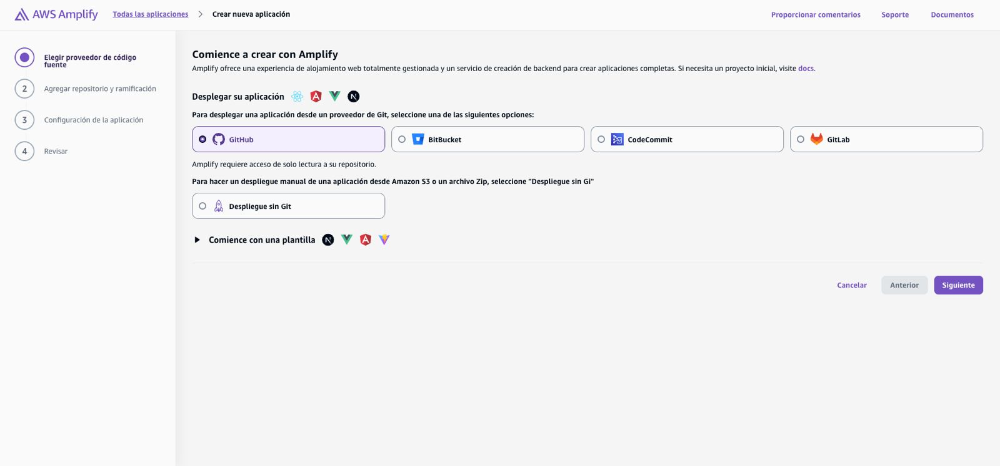
    
  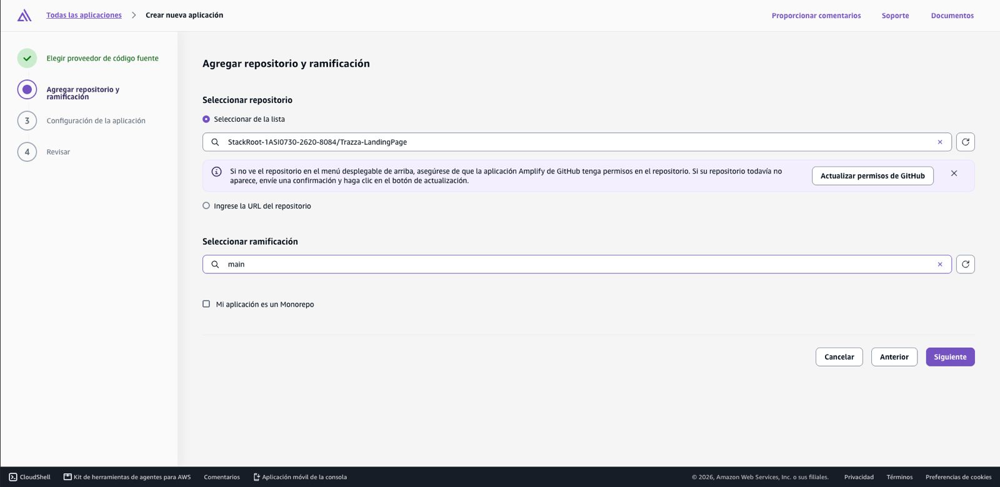
    
  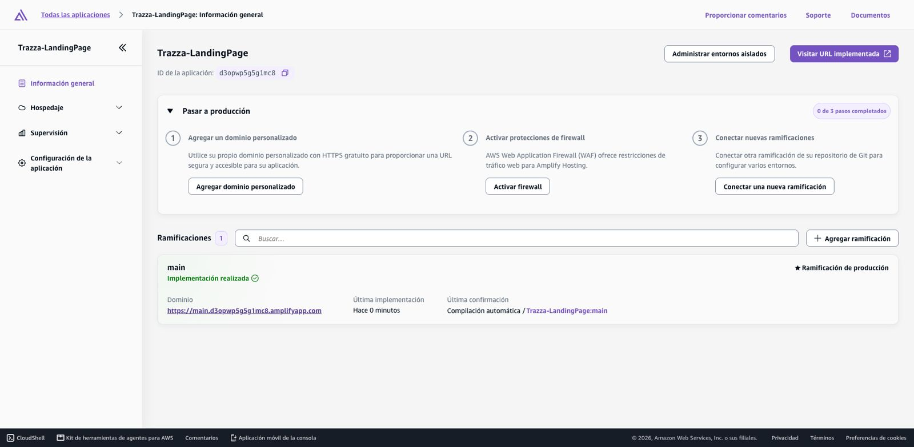

**Video de navegación del Sprint 1:** [upc-pre-202620-1asi0730-8084-StackRoot-productnavigation-sprint-1.mp4](https://upcedupe-my.sharepoint.com/:v:/g/personal/u202414356_upc_edu_pe/IQAHwNmBh-BrSIywebxTh1XRAXSQ67CxwXjsw4F17WnJ3nQ?e=dc5eL3&nav=eyJyZWZlcnJhbEluZm8iOnsicmVmZXJyYWxBcHAiOiJTdHJlYW1XZWJBcHAiLCJyZWZlcnJhbFZpZXciOiJTaGFyZURpYWxvZy1MaW5rIiwicmVmZXJyYWxBcHBQbGF0Zm9ybSI6IldlYiIsInJlZmVycmFsTW9kZSI6InZpZXcifX0%3D)
 
#### 5.2.1.6. Services Documentation Evidence for Sprint Review
 
El alcance del Sprint 1 se limitó al Landing Page, que es un sitio estático. Por ello, en este Sprint no se implementaron ni documentaron endpoints con OpenAPI. Los Web Services de Trazza se implementarán en Spring Boot en un Sprint posterior.
 
#### 5.2.1.7. Software Deployment Evidence for Sprint Review
 
En el Sprint 1 se creó la aplicación en AWS Amplify Hosting y se conectó con la rama `main` del repositorio `Trazza-landingPage`, siguiendo los pasos descritos en la sección 5.1.4. Al ser un sitio estático, no requiere comando de build. Desde entonces, cada cambio integrado en `main` se publica automáticamente.
 
**URL del Landing Page:** [https://main.dop9j8vefsnfj.amplifyapp.com](https://main.dop9j8vefsnfj.amplifyapp.com)
 

  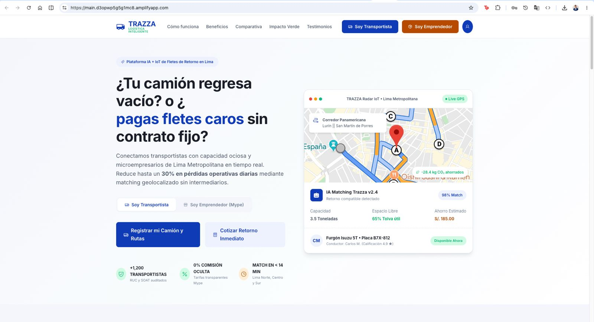

#### 5.2.1.8. Team Collaboration Insights during Sprint
 
En el Sprint 1 el equipo trabajó en dos repositorios. En `Trazza-landingPage` se registraron 2 commits: Pezo Castilla, Maria Jose (estructura inicial) y Peñaranda Caldas, Gabriel Augusto (primera versión completa), ambos directamente en `main`. En `Trazza-report` cada sección del informe se trabajó en su rama `feature/*` y se integró a `develop` mediante Pull Requests, con commits de los cinco integrantes.
 
Los gráficos de Contributors muestran las contribuciones semanales de cada integrante. Las barras de las semanas del 7 y 14 de septiembre corresponden al Sprint 1.
 

  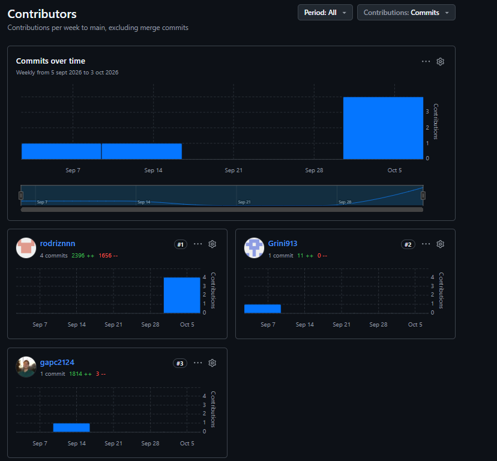
    
  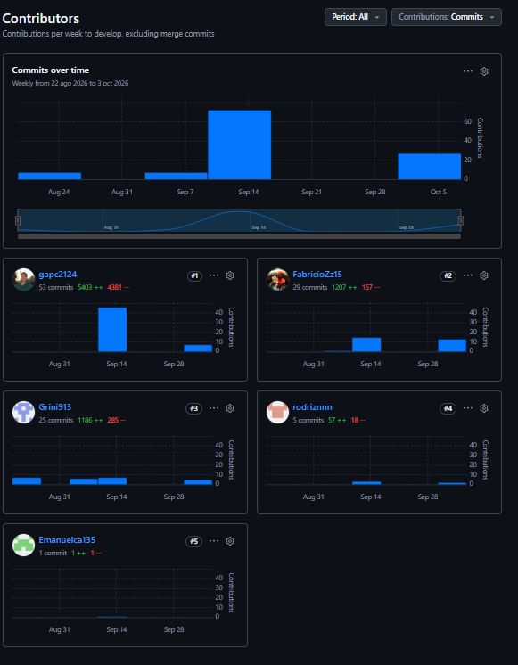
    
  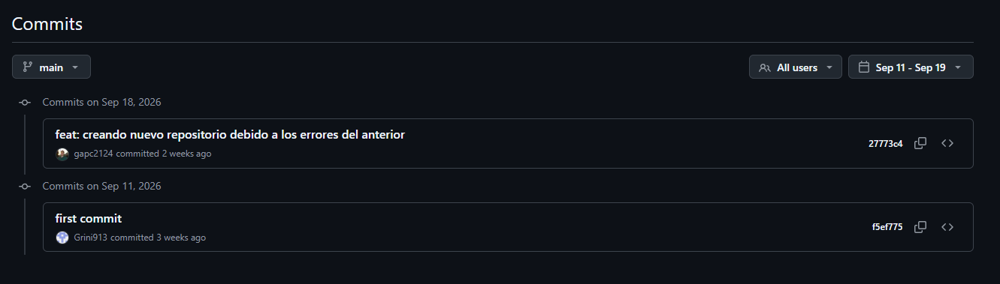
    
  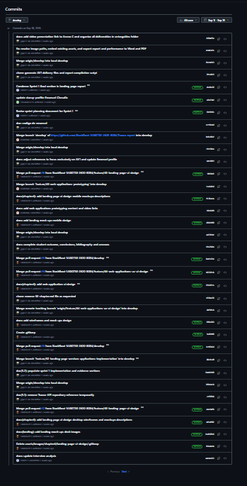

### 5.2.2. Sprint 2

En esta sección se registra el avance en producto y en trabajo colaborativo correspondiente al Sprint 2.

#### 5.2.2.1. Sprint Planning 2

En el Sprint Planning 2 el equipo definió el objetivo del Sprint y seleccionó las User Stories correspondientes de acuerdo con su prioridad dentro del Product Backlog.

| Sprint # | Sprint 2 |
| :--- | :--- |
| **Sprint Planning Background** | |
| Date |05/10/2026 |
| Time | 10:00 p.m |
| Location | Modalidad Remota a través de la plataforma Discord |
| Prepared By |  Peñaranda Caldas, Gabriel Augusto |
| Attendees (to planning meeting) | Checalla Apaza, Emanuel Renato / Lozano Quispe, Fabricio Jofred / Pezo Castilla, Maria Jose / Peñaranda Caldas, Gabriel Augusto / Vite Celis, Rodrigo Matias |
| Sprint 1 Review Summary | En este sprint, el equipo avanzó en la primera versión funcional de Trazza, desarrollando la Landing Page y las funcionalidades iniciales de registro y autenticación. También se establecieron las bases para la integración y despliegue de los componentes del sistema. Como mejora, identificamos la necesidad de seguir refinando la experiencia de usuario y fortalecer la integración entre los diferentes módulos. |
| Sprint 1 Retrospective Summary | Durante este sprint, el equipo mantuvo una colaboración constante mediante la distribución de responsabilidades y el uso de GitHub para integrar los avances. Sin embargo, se identificaron oportunidades de mejora en la coordinación de tareas, comunicación e integración de cambios entre ramas. Para el siguiente sprint, buscaremos mejorar la organización del trabajo y mantener una comunicación más constante entre los integrantes. |
| **Sprint Goal & User Stories** | |
| Sprint 2 Goal | **Nuestro enfoque está en** desplegar la primera versión funcional del frontend de la aplicación web de Trazza. **Creemos que esto entrega** una experiencia de navegación interactiva y acceso preliminar a la plataforma **a** nuestros transportistas y emprendedores MYPE. **Esto se confirmará cuando** los usuarios puedan ingresar al entorno web alojado en la nube y logren navegar correctamente por las principales vistas implementadas sin errores. |
| Sprint 2 Velocity |30 Story Points. |
| Sum of Story Points | 30 Story Points. |

#### 5.2.2.2. Aspect Leaders and Collaborators

En esta sección se presentan los líderes y colaboradores responsables de los principales aspectos desarrollados durante el Sprint 2.

| Team Member (Last Name, First Name) | GitHub Username | Landing Page Implementation (L/C) | Landing Page UI Design (L/C) | Landing Page Deployment (L/C) |
| :--- | :--- | :---: | :---: | :---: |
| Checalla Apaza, Emanuel Renato | Emanuelca135 | C | C | C |
| Lozano Quispe, Fabricio Jofred | FabricioZz15 | C | L | C |
| Pezo Castilla, Maria Jose | MariaJosePezo | L | C | C |
| Peñaranda Caldas, Gabriel Augusto | gapc2124 | C | C | C |
| Vite Celis, Rodrigo Matias | rodriznnn | C | C | C |

#### 5.2.2.3. Sprint Backlog 2

En esta sección se detallan las User Stories y las tareas seleccionadas para el Sprint 2, cuyo foco fue desplegar la primera versión funcional de la Web Application (Frontend) e implementar las vistas principales de registro, inicio de sesión y gestión de solicitudes básicas.

**URL público del Board:** [https://trazza.atlassian.net/jira/software/projects/SCRUM/boards/1/backlog?atlOrigin=eyJpIjoiODY4YWQ1NTBiM2VkNGYzOTkwZmMxMjY1MWE1MGEwYTciLCJwIjoiaiJ9](https://trazza.atlassian.net/jira/software/projects/SCRUM/boards/1/backlog?atlOrigin=eyJpIjoiODY4YWQ1NTBiM2VkNGYzOTkwZmMxMjY1MWE1MGEwYTciLCJwIjoiaiJ9)

| Sprint # | Sprint 2 | | | | | | |
| :--- | :--- | :--- | :--- | :--- | :--- | :--- | :--- |
| **User Story** | | **Work-Item / Task** | | | | | |
| **Id** | **Title** | **Id** | **Title** | **Description** | **Estimation (Hours)** | **Assigned To** | **Status** |
| US01 | Registro de Transportista | T07 | UI Formulario de Registro Transportista | Implementar la vista del formulario de registro y validaciones para el transportista. | 6 | Pezo Castilla, Maria Jose | Done |
| US02 | Registro de Emprendedor | T08 | UI Formulario de Registro Emprendedor | Implementar la vista del formulario de registro y validaciones para el emprendedor. | 6 | Checalla Apaza, Emanuel Renato | Done |
| US03 | Inicio de Sesión de Usuario | T09 | Pantalla de Login (Web App) | Desarrollar la vista de inicio de sesión con enrutamiento hacia el dashboard respectivo. | 5 | Peñaranda Caldas, Gabriel Augusto | Done |
| US08 | Publicación de Ruta de Retorno | T10 | Vista Dashboard Transportista | Diseñar la interfaz principal del transportista con el botón y modal para publicar rutas. | 8 | Lozano Quispe, Fabricio Jofred | Done |
| US09 | Solicitud de Envío de Mercadería | T11 | Vista Dashboard Emprendedor | Diseñar la interfaz principal del emprendedor para solicitar un envío (formulario de carga). | 8 | Vite Celis, Rodrigo Matias | Done |
| — | Constraint: Configuración | T12 | Estructura Base Web App | Configurar el repositorio del Frontend (Angular/React), routing base y dependencias de diseño. | 4 | Peñaranda Caldas, Gabriel Augusto | Done |
| — | Constraint: Despliegue | T13 | Despliegue Frontend en Cloud | Desplegar la aplicación web funcional conectada a un entorno de prueba público. | 4 | Pezo Castilla, Maria Jose | Done |

#### 5.2.2.4. Development Evidence for Sprint Review

En esta sección se presentan las evidencias de desarrollo correspondientes al Sprint 2. La siguiente tabla registra los principales commits realizados en los repositorios del proyecto, destacando la implementación del Frontend y la documentación del informe.

| Repository | Branch | Commit Id | Commit Message | Commit Message Body | Committed on (Date) |
| :--- | :--- | :--- | :--- | :--- | :--- |
| NexusLibre-1ASI0729-2620-16692/Trazza-webApp | main | 8a1f2c3 | feat: init angular project structure | - | 2026-10-02 |
| NexusLibre-1ASI0729-2620-16692/Trazza-webApp | develop | 3b9c8d1 | feat: implement register and login forms | - | 2026-10-03 |
| NexusLibre-1ASI0729-2620-16692/Trazza-webApp | develop | d4e7a5b | feat: create base dashboard components | - | 2026-10-04 |
| NexusLibre-1ASI0729-2620-16692/Trazza-report | feature/cap5-sprint2 | c710b44 | docs: add part of sprint 2 documentation | - | 2026-10-05 |
| NexusLibre-1ASI0729-2620-16692/Trazza-report | develop | fde8d18 | Merge branch 'feature/chepter4-Diagramsv2' into develop | - | 2026-10-05 |

#### 5.2.2.5. Execution Evidence for Sprint Review

En esta sección se presentan las evidencias de ejecución de las funcionalidades implementadas durante el Sprint 2.

| Evidence | Description | Related User Story | Status |
| :--- | :--- | :--- | :--- |
| UI Component | Landing Page: Propuesta para Transportistas | US04 | Finalizado |
| UI Component | Landing Page: Propuesta para Emprendedores | US05 | Finalizado |
| UI Component | Landing Page: Testimonios de Éxito | US25 | Finalizado |

  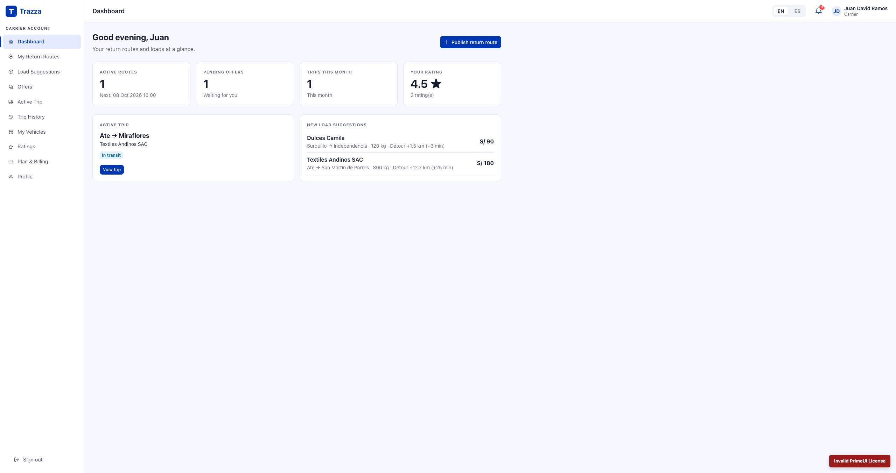
    
  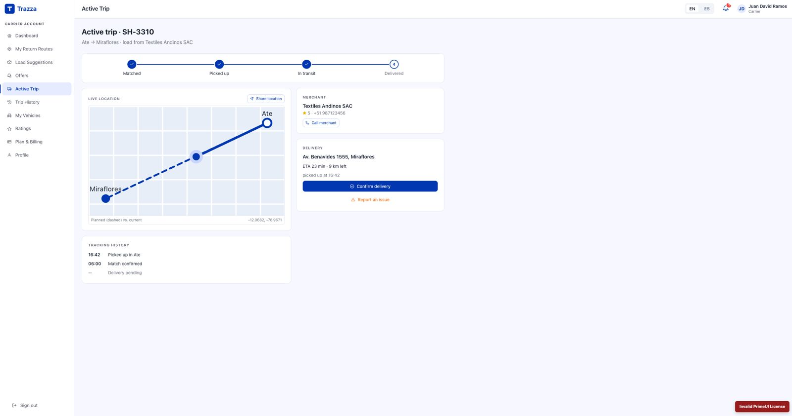
    
  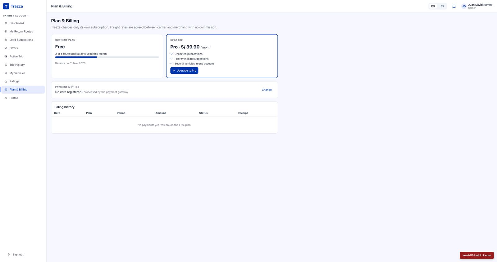

**Video de navegación del Sprint 2:** [upc-pre-202620-1asi0729-16692-NexusLibre-keynote-tb1.mp4](https://upcedupe-my.sharepoint.com/:v:/g/personal/u202210836_upc_edu_pe/IQB4iIieEXLgTY0NDGDKdOCWAffPuq2jSt2JscaEYz-EMaQ?e=R1rXS0&nav=eyJyZWZlcnJhbEluZm8iOnsicmVmZXJyYWxBcHAiOiJTdHJlYW1XZWJBcHAiLCJyZWZlcnJhbFZpZXciOiJTaGFyZURpYWxvZy1MaW5rIiwicmVmZXJyYWxBcHBQbGF0Zm9ybSI6IldlYiIsInJlZmVycmFsTW9kZSI6InZpZXcifX0%3D)

#### 5.2.2.6. Services Documentation Evidence for Sprint Review

Dado que el objetivo principal del Sprint 2 se enfocó en el diseño, desarrollo y despliegue del **Frontend Web Application**, la implementación de la API REST y su documentación (Swagger/OpenAPI) se encuentra programada para los siguientes Sprints de integración.

  <!-- Evidencias de Swagger se agregarán en el Sprint 3 -->

#### 5.2.2.7. Software Deployment Evidence for Sprint Review

En esta sección se presentan las evidencias relacionadas con el despliegue del software desarrollado durante el Sprint 2.

| Software Component | Deployment Platform | Repository / Branch | Deployment URL | Status |
| :--- | :--- | :--- | :--- | :--- |
| Frontend Web App | AWS Amplify | Trazza-webApp / main | https://main.d11tospvoprjej.amplifyapp.com | Active |
| Landing Page v2 | AWS Amplify | Trazza-landingPage / main | https://main.dop9j8vefsnfj.amplifyapp.com | Active |

**URL de despliegue (Web App):** https://main.d11tospvoprjej.amplifyapp.com

  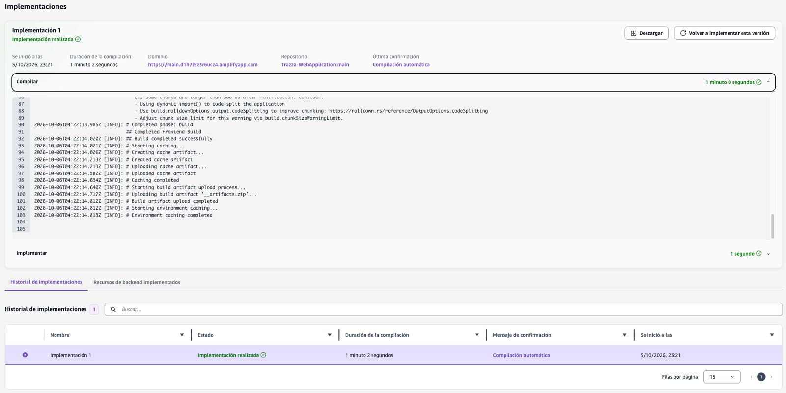

#### 5.2.2.8. Team Collaboration Insights during Sprint

En esta sección se presentan las evidencias de colaboración del equipo durante el Sprint 2, considerando las contribuciones realizadas por cada integrante en los repositorios del proyecto.

| Team Member | GitHub Username | Repository | Commits | Pull Requests | Main Contribution |
| :--- | :--- | :--- | :---: | :---: | :--- |
| Checalla Apaza, Emanuel Renato | Emanuelca135 | Trazza-webApp / Trazza-report | 8 | 2 | Desarrollo del registro de Emprendedor y documentación. |
| Lozano Quispe, Fabricio Jofred | FabricioZz15 | Trazza-webApp / Trazza-report | 7 | 2 | Interfaz del Dashboard de Transportista y diseño UI. |
| Pezo Castilla, Maria Jose | Grini913 | Trazza-webApp / Trazza-report | 10 | 3 | Despliegue, estructura base, y Registro de Transportista. |
| Peñaranda Caldas, Gabriel Augusto | gapc2124 | Trazza-webApp / Trazza-report | 12 | 3 | Login, ruteo de la aplicación, y resolución de conflictos. |
| Vite Celis, Rodrigo Matias | rodriznnn | Trazza-webApp / Trazza-report | 7 | 2 | Interfaz del Dashboard de Emprendedor (solicitud de carga). |

Los gráficos de Contributors muestran las contribuciones realizadas por cada integrante durante el Sprint 2.

  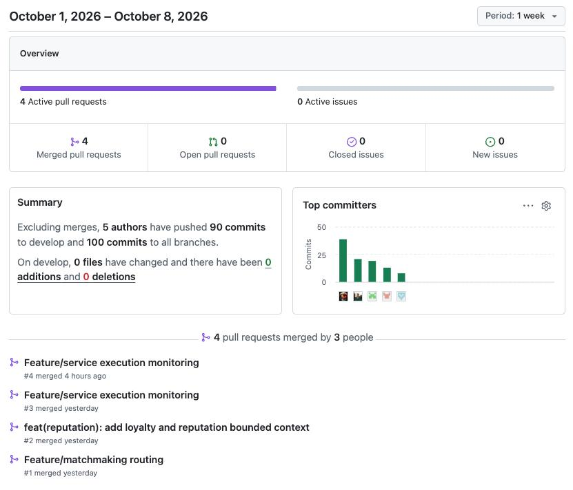
    
  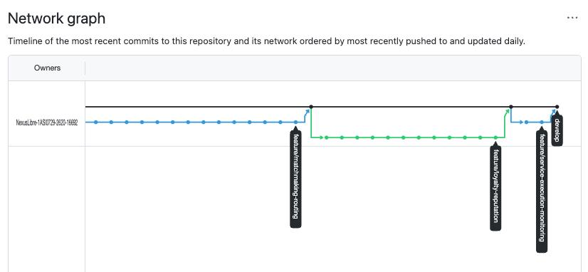
    
  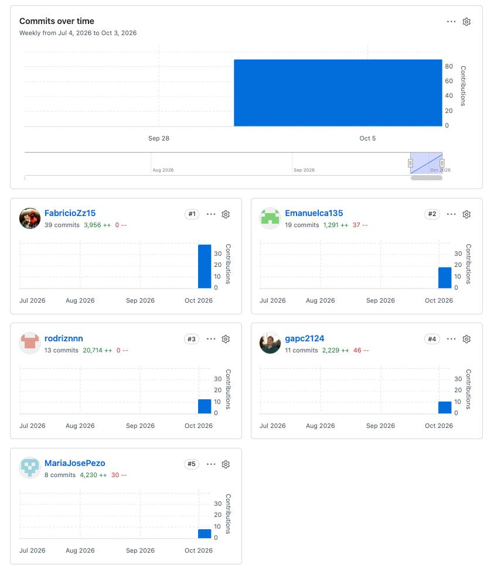

### 5.2.3. Sprint 3

En esta sección se registra el avance en producto y en trabajo colaborativo correspondiente al Sprint 3, cuyo alcance fue la implementación de los Web Services de Trazza en Java con Spring Boot aplicando Domain-Driven Design, la integración de la Web Application en Angular con dichos servicios y el despliegue de todos los productos en AWS.

#### 5.2.3.1. Sprint Planning 3

En el Sprint Planning 3 el equipo revisó lo alcanzado en el Sprint 2, definió el objetivo del Sprint y seleccionó las User Stories necesarias para que la plataforma funcione de punta a punta con un backend real.

| Sprint # | Sprint 3 |
| :--- | :--- |
| **Sprint Planning Background** | |
| Date | 14/11/2026 |
| Time | 05:00 p.m. |
| Location | |
| Prepared By | Peñaranda Caldas, Gabriel Augusto |
| Attendees (to planning meeting) | Checalla Apaza, Emanuel Renato / Lozano Quispe, Fabricio Jofred / Pezo Castilla, Maria Jose / Peñaranda Caldas, Gabriel Augusto / Vite Celis, Rodrigo Matias |
| Sprint 2 Review Summary | En el Sprint 2 se publicó en AWS Amplify la primera versión funcional del frontend de Trazza, con las vistas de registro, inicio de sesión y los dashboards del transportista y del emprendedor. La aplicación consumía datos de un servidor simulado (json-server), por lo que los flujos aún no se conectaban con un backend real ni persistían información. Como mejora, se acordó implementar los Web Services y conectar la aplicación a ellos para cubrir el flujo completo de un envío. |
| Sprint 2 Retrospective Summary | El equipo valoró la división del trabajo por vistas y el uso de GitHub para integrar los avances. Se identificaron como puntos de mejora la integración tardía entre ramas, la falta de una convención común de paquetes y nombres, y la necesidad de revisar los cambios antes de integrarlos. Para el Sprint 3 se acordó organizar el trabajo por bounded context, aplicar GitFlow con ramas `feature/*`, `release/*` y `hotfix/*`, e integrar mediante Pull Requests. |
| **Sprint Goal & User Stories** | |
| Sprint 3 Goal | **Nuestro enfoque está en** implementar los Web Services de Trazza en Java con Domain-Driven Design, integrar la aplicación web en Angular con dichos servicios y desplegar todos los productos en AWS. **Creemos que esto entrega** una plataforma funcional de punta a punta donde publicar rutas de retorno, solicitar envíos, negociar, hacer seguimiento del viaje y calificar **a** transportistas independientes y emprendedores MYPE de Lima. **Esto se confirmará cuando** un usuario pueda registrarse, iniciar sesión y completar desde la aplicación desplegada el flujo de un envío con datos persistidos en la base de datos en la nube. |
| Sprint 3 Velocity | 133 Story Points |
| Sum of Story Points | 133 Story Points (US01: 3, US02: 3, US03: 3, US06: 5, US07: 5, US08: 5, US09: 5, US10: 5, US11: 5, US12: 5, US13: 5, US14: 5, US15: 8, US16: 5, US17: 5, US18: 5, US19: 2, US20: 2, US21: 2, US22: 5, US23: 3, US24: 5, US26: 8, US27: 5, US29: 8, US30: 8, US31: 8). La User Story US28 también se trabajó en este Sprint, pero no cuenta con estimación en el Product Backlog. |

#### 5.2.3.2. Aspect Leaders and Collaborators

En el Sprint 3 los aspectos corresponden a los bounded contexts de la solución, implementados tanto en los Web Services como en la Web Application, más el despliegue en AWS. Los líderes se asignaron según la participación registrada en los repositorios `webservice` y `Trazza-webApp`.

| Team Member (Last Name, First Name) | GitHub Username | IAM (L/C) | Matchmaking (L/C) | Execution (L/C) | Billing (L/C) | Reputation (L/C) | AWS Deployment (L/C) |
| :--- | :--- | :---: | :---: | :---: | :---: | :---: | :---: |
| Checalla Apaza, Emanuel Renato | Emanuelca135 / Petalia-Cosmetica | C | C | C | C | C | C |
| Lozano Quispe, Fabricio Jofred | FabricioZz15 | C | L | C | L | C | C |
| Pezo Castilla, Maria Jose | MariaJosePezo | C | C | L | C | C | C |
| Peñaranda Caldas, Gabriel Augusto | gapc2124 | L | C | C | C | C | L |
| Vite Celis, Rodrigo Matias | rodriznnn | C | C | C | C | L | C |

#### 5.2.3.3. Sprint Backlog 3

El objetivo del Sprint 3 fue contar con una plataforma funcional de punta a punta: Web Services en Java desplegados en AWS y una Web Application en Angular integrada con ellos. Las User Stories del Sprint se agrupan por bounded context.

**URL público del Board:** [https://trazza.atlassian.net/jira/software/projects/SCRUM/boards/1/backlog](https://trazza.atlassian.net/jira/software/projects/SCRUM/boards/1/backlog)

| Sprint # | Sprint 3 | | | | | | |
| :--- | :--- | :--- | :--- | :--- | :--- | :--- | :--- |
| **User Story** | | **Work-Item / Task** | | | | | |
| **Id** | **Title** | **Id** | **Title** | **Description** | **Estimation (Hours)** | **Assigned To** | **Status** |
| US01 | Registro de Transportista | | | | | | |
| US02 | Registro de Emprendedor | | | | | | |
| US03 | Inicio de Sesión de Usuario | | | | | | |
| US06 | Autenticación de Usuarios vía API (RESTful API) | | | | | | |
| US07 | Registro de Usuarios vía API (RESTful API) | | | | | | |
| US26 | Validación de Identidad (KYC) | | | | | | |
| US23 | Registro de Nuevo Vehículo | | | | | | |
| US08 | Publicación de Ruta de Retorno | | | | | | |
| US09 | Solicitud de Envío de Mercadería | | | | | | |
| US10 | Sugerencias Automáticas de Carga | | | | | | |
| US11 | Búsqueda Manual de Transportistas | | | | | | |
| US12 | Aceptar Solicitud de Carga | | | | | | |
| US13 | Negociación y Propuesta de Tarifa | | | | | | |
| US14 | Consulta de Rutas Disponibles vía API (RESTful API) | | | | | | |
| US27 | Cancelación Temprana de Solicitud | | | | | | |
| US29 | Mensajería Integrada (Chat) | | | | | | |
| US15 | Visualización de Ubicación en Vivo | | | | | | |
| US16 | Confirmación de Recojo de Mercadería | | | | | | |
| US17 | Confirmación de Entrega | | | | | | |
| US18 | Registro de Ubicación GPS vía API (RESTful API) | | | | | | |
| US21 | Reportar Problemas con la Carga | | | | | | |
| US24 | Historial de Envíos | | | | | | |
| US30 | Alerta de Desvío en Ruta | | | | | | |
| US28 | Gestión de Compensación (Lucro Cesante) | | | | | | |
| US31 | Confirmación de Recepción y Pago | | | | | | |
| US19 | Calificación del Transportista | | | | | | |
| US20 | Calificación del Cliente | | | | | | |
| US22 | Registro de Calificaciones vía API (RESTful API) | | | | | | |

#### 5.2.3.4. Development Evidence for Sprint Review

En el Sprint 3 se creó el repositorio `webservice`, donde se implementaron los Web Services de Trazza con Spring Boot 3 y Java 21, organizados en los bounded contexts IAM, Matchmaking, Execution, Billing y Reputation, más un módulo `shared` con los elementos comunes. Cada bounded context sigue las capas de Domain-Driven Design: `domain`, `application`, `infrastructure` e `interfaces`. En el repositorio `Trazza-webApp` se reorganizó la aplicación Angular con la misma división por bounded context y se reemplazó el servidor simulado por la API real. El trabajo se integró siguiendo GitFlow y se publicaron las versiones `v1.0.0` y `v1.0.1` del backend y `v1.2.0` del frontend. La siguiente tabla muestra los commits principales relacionados con la implementación.

| Repository | Branch | Commit Id | Commit Message | Commit Message Body | Committed on (Date) |
| :--- | :--- | :--- | :--- | :--- | :--- |
| NexusLibre-1ASI0729-2620-16692/webservice | feature/shared | f5e7d5b | feat(shared): add OpenApiConfiguration | - | 2026-11-12 |
| NexusLibre-1ASI0729-2620-16692/webservice | feature/shared | c532e3a | test(shared): add PublicIdConverterTest | - | 2026-11-12 |
| NexusLibre-1ASI0729-2620-16692/webservice | feature/service-execution-monitoring | 762095e | test(execution): add TripTest | - | 2026-11-12 |
| NexusLibre-1ASI0729-2620-16692/webservice | feature/payment-billing | 0f3eeca | feat(billing): add SubscribeResource | - | 2026-11-13 |
| NexusLibre-1ASI0729-2620-16692/webservice | feature/loyalty-reputation | 1e7cdef | feat(reputation): add LoyaltyController | - | 2026-11-13 |
| NexusLibre-1ASI0729-2620-16692/webservice | feature/matchmaking-routing | 2ef1355 | feat(matchmaking): add ShipmentRequestsController | - | 2026-11-13 |
| NexusLibre-1ASI0729-2620-16692/webservice | feature/iam-profiles | 4f11e8b | feat(iam): add REST controllers for authentication and fleet management | - | 2026-11-14 |
| NexusLibre-1ASI0729-2620-16692/webservice | feature/iam-core | 77cb53b | feat(config): add datasource and jpa settings | - | 2026-11-14 |
| NexusLibre-1ASI0729-2620-16692/webservice | main | 8db72e0 | merge: release 1.0.0 into main | - | 2026-11-14 |
| NexusLibre-1ASI0729-2620-16692/webservice | hotfix/1.0.1 | 1b3832b | fix(iam): use jackson 3 object mapper | - | 2026-11-14 |
| NexusLibre-1ASI0729-2620-16692/webservice | main | c42955b | merge: hotfix 1.0.1 into main | - | 2026-11-14 |
| NexusLibre-1ASI0729-2620-16692/Trazza-webApp | feature/shared | bf575df | feat(shared): add platform api, api error handling and feedback attempt | - | 2026-11-13 |
| NexusLibre-1ASI0729-2620-16692/Trazza-webApp | feature/service-execution-monitoring | 840cfef | refactor(execution): update execution module | - | 2026-11-13 |
| NexusLibre-1ASI0729-2620-16692/Trazza-webApp | feature/payment-billing | 37c1948 | feat(i18n): add English labels for billing | - | 2026-11-13 |
| NexusLibre-1ASI0729-2620-16692/Trazza-webApp | feature/loyalty-reputation | 9b14288 | feat(reputation): add loyalty points menu translations | - | 2026-11-13 |
| NexusLibre-1ASI0729-2620-16692/Trazza-webApp | feature/matchmaking-routing | c5c0e39 | feat(i18n): add matchmaking and execution labels | - | 2026-11-14 |
| NexusLibre-1ASI0729-2620-16692/Trazza-webApp | feature/iam-profiles | a072653 | fix(shared): update status severities | - | 2026-11-14 |
| NexusLibre-1ASI0729-2620-16692/Trazza-webApp | main | 9775bed | merge: release 1.2.0 into main | - | 2026-11-14 |
| NexusLibre-1ASI0729-2620-16692/Trazza-webApp | main | d2cccbe | chore(env): point api to new backend | - | 2026-11-14 |

#### 5.2.3.5. Execution Evidence for Sprint Review

Al cierre del Sprint 3, la Web Application de Trazza funciona de punta a punta sobre los Web Services. El emprendedor publica una solicitud de envío y el transportista publica su ruta de retorno, con sugerencias de carga compatible según la capacidad libre de su camión. Ambos negocian la tarifa en una oferta con chat integrado. Una vez aceptada la oferta se abre el viaje, que se sigue en un mapa con los puntos GPS, el historial de estados y el reporte de incidentes. El transportista también puede revisar los planes de monitoreo de su flota. Las capturas se tomaron con datos de muestra.

  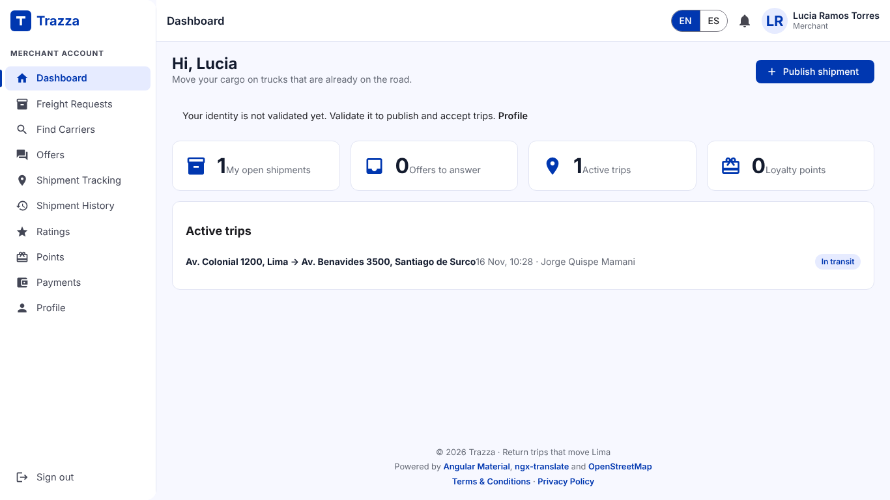
    
  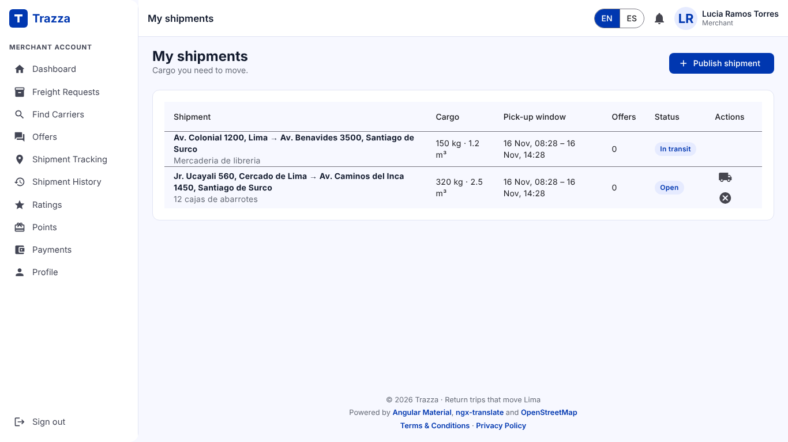
    
  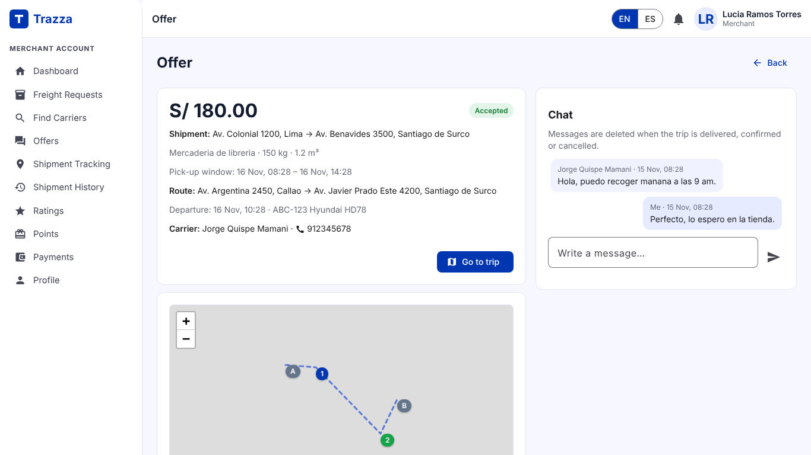
    
  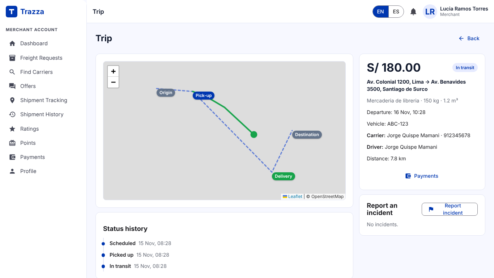
    
  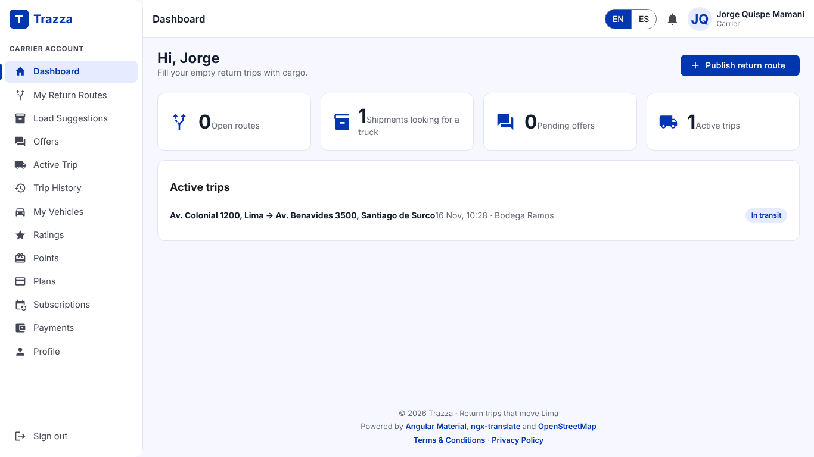
    
  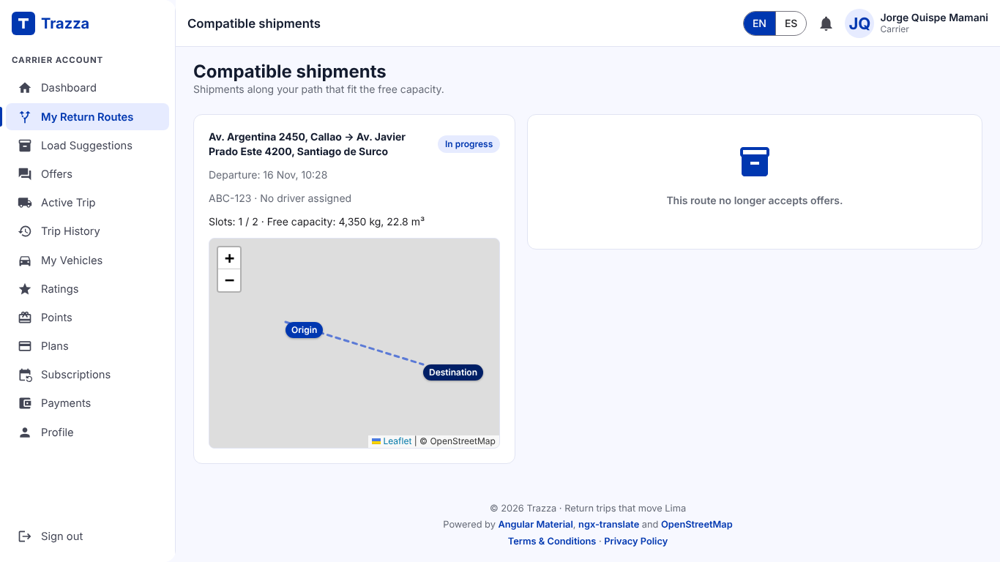
    
  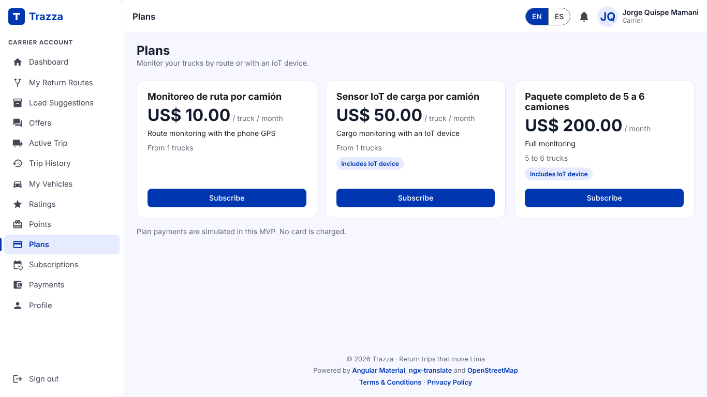

**Video de navegación del Sprint 3:**

#### 5.2.3.6. Services Documentation Evidence for Sprint Review

En el Sprint 3 se documentaron con OpenAPI 3.1 todos los endpoints de los Web Services, mediante la librería springdoc-openapi. La documentación se genera a partir de los controladores, describe cada operación con un resumen, agrupa los endpoints por recurso e indica cuáles requieren un token JWT (esquema Bearer). La interfaz Swagger UI se publica en la ruta `/swagger-ui.html` y la especificación en `/v3/api-docs`. La siguiente tabla resume los endpoints principales. Todas las rutas parten de la URL base `/api/v1`.

| Endpoint | Acción | Verbo HTTP | Sintaxis de llamada | Parámetros | Ejemplo de response |
| :--- | :--- | :---: | :--- | :--- | :--- |
| Authentication | Crear una cuenta (transportista, emprendedor o ambos) e iniciar sesión | POST | `/api/v1/authentication/sign-up` | Body: `email`, `password`, `fullName`, `dni`, `phone`, `roles`, `merchant` (`businessName`, `ruc`, `businessType`) | `200 OK` con `accessToken`, `accessTokenExpiresAt` y `refreshToken`. Si el RUC no tiene 11 dígitos responde `400` con `code: "ruc-invalid"`. |
| Authentication | Iniciar sesión con correo y contraseña | POST | `/api/v1/authentication/sign-in` | Body: `email`, `password` | `200 OK` con `accessToken` (JWT válido por 60 minutos) y `refreshToken` (válido por 14 días). |
| Authentication | Renovar el access token | POST | `/api/v1/authentication/refresh` | Body: `refreshToken` | `200 OK` con un nuevo par de tokens; el refresh token anterior queda revocado. |
| Users | Obtener la cuenta del usuario autenticado | GET | `/api/v1/users/me` | Header: `Authorization: Bearer <token>` | `200 OK` con los datos de la cuenta, sus roles y su perfil. |
| Users | Validar la identidad (RENIEC simulado) | POST | `/api/v1/users/me/identity-verifications` | Body: `documentFrontS3Key`, `documentBackS3Key` | `200 OK` con `provider: "RENIEC_SIMULATED"`, `status: "VALIDATED"` y `externalReference`. |
| Vehicles | Registrar un camión | POST | `/api/v1/vehicles` | Body: `plate`, `model`, `maxLoadKg`, `cargoLengthM`, `cargoWidthM`, `cargoHeightM`, `cargoVolumeM3`, `isActive` | `200 OK` con el camión creado, por ejemplo `plate: "ABC-123"`, `maxLoadKg: 4500`, `cargoVolumeM3: 24`. |
| Drivers | Registrar un conductor | POST | `/api/v1/drivers` | Body: `fullName`, `sex` (F, M o X), `experienceStars` (1 a 5), `isActive` | `200 OK` con el conductor creado. |
| Return routes | Publicar una ruta de retorno | POST | `/api/v1/return-routes` | Body: `vehicleId`, `driverId`, `origin`, `destination` (`address`, `latitude`, `longitude`), `departureAt`, `maxShipments` (1 o 2) | `200 OK` con la ruta en estado `PUBLISHED`, el vehículo y la capacidad libre. |
| Return routes | Listar envíos compatibles con la ruta | GET | `/api/v1/return-routes/{routeId}/suggested-shipments` | Path: `routeId` | `200 OK` con la lista de solicitudes abiertas que caben en la capacidad libre del camión. |
| Shipment requests | Publicar una solicitud de envío | POST | `/api/v1/shipment-requests` | Body: `description`, `weightKg`, `volumeM3`, `pickup`, `delivery`, `pickupFrom`, `pickupUntil` | `200 OK` con la solicitud en estado `OPEN`, por ejemplo `description: "12 cajas de abarrotes"`, `weightKg: 320`. |
| Shipment requests | Rutas publicadas que podrían llevar el envío | GET | `/api/v1/shipment-requests/{shipmentId}/suggested-routes` | Path: `shipmentId` | `200 OK` con las rutas de retorno compatibles con el envío. |
| Shipment requests | Cancelar una solicitud abierta | POST | `/api/v1/shipment-requests/{shipmentId}/cancel` | Path: `shipmentId` | `200 OK` con la solicitud en estado cancelado. |
| Match proposals | Ofrecer una tarifa para llevar un envío | POST | `/api/v1/match-proposals` | Body: `shipmentRequestId`, `returnRouteId`, `offeredRate`, `currency` | `200 OK` con la oferta en estado `PENDING`, por ejemplo `offeredRate: 180.0`, `currency: "PEN"`. |
| Match proposals | Aceptar una oferta (abre el viaje) | POST | `/api/v1/match-proposals/{proposalId}/accept` | Path: `proposalId` | `200 OK` con la oferta en estado `ACCEPTED` y la fecha `respondedAt`. |
| Match proposals | Enviar un mensaje en el chat de la oferta | POST | `/api/v1/match-proposals/{proposalId}/messages` | Path: `proposalId`. Body: `content` | `200 OK` con el mensaje, el nombre del remitente y la fecha `sentAt`. |
| Trips | Listar los viajes del usuario | GET | `/api/v1/trips` | Header: `Authorization: Bearer <token>` | `200 OK` con los viajes, por ejemplo `status: "SCHEDULED"`, `myRole: "MERCHANT"`, `agreedRate: 180.0`. |
| Trips | Confirmar el recojo de la carga | POST | `/api/v1/trips/{tripId}/pick-up` | Path: `tripId` | `200 OK` con el viaje actualizado al estado de recojo. |
| Trips | Registrar un punto GPS | POST | `/api/v1/trips/{tripId}/tracking-points` | Path: `tripId`. Body: `latitude`, `longitude`, `speedKmh`, `source` (PHONE o IOT), `recordedAt` | `200 OK` con el punto registrado; el viaje pasa a `IN_TRANSIT`. |
| Trips | Confirmar la entrega | POST | `/api/v1/trips/{tripId}/deliver` | Path: `tripId` | `200 OK` con el viaje en estado entregado. |
| Trips | Reportar un incidente | POST | `/api/v1/trips/{tripId}/incidents` | Path: `tripId`. Body con la descripción del incidente | `200 OK` con el incidente registrado. |
| Freight settlements | El transportista confirma que recibió el flete | POST | `/api/v1/freight-settlements/{tripId}/confirm` | Path: `tripId` | `200 OK` con la liquidación del flete confirmada. |
| Plans | Listar los planes activos | GET | `/api/v1/plans` | Ninguno | `200 OK` con los planes, por ejemplo `ROUTE_PER_TRUCK` a `10.0 USD` mensuales por camión e `IOT_PER_TRUCK` a `50.0 USD`. |
| Subscriptions | Suscribir camiones a un plan (pago simulado) | POST | `/api/v1/subscriptions` | Body con el plan y los camiones | `200 OK` con la suscripción creada. |
| Ratings | Calificar a la otra parte de un viaje confirmado | POST | `/api/v1/ratings` | Body con el viaje, la puntuación de 1 a 5 y el comentario | `200 OK` con la calificación registrada. |
| Ratings | Promedio de calificaciones de un usuario | GET | `/api/v1/ratings/summary/{userId}` | Path: `userId` | `200 OK` con el promedio y la cantidad de calificaciones. |
| Loyalty | Saldo e historial de puntos | GET | `/api/v1/loyalty/points` | Header: `Authorization: Bearer <token>` | `200 OK` con el saldo de puntos y sus movimientos. |

En las siguientes capturas se muestra la interacción con la documentación en Swagger UI usando datos de muestra: la vista general de la API, la ejecución de `GET /api/v1/plans` con su response y el detalle de `POST /api/v1/authentication/sign-in`.

  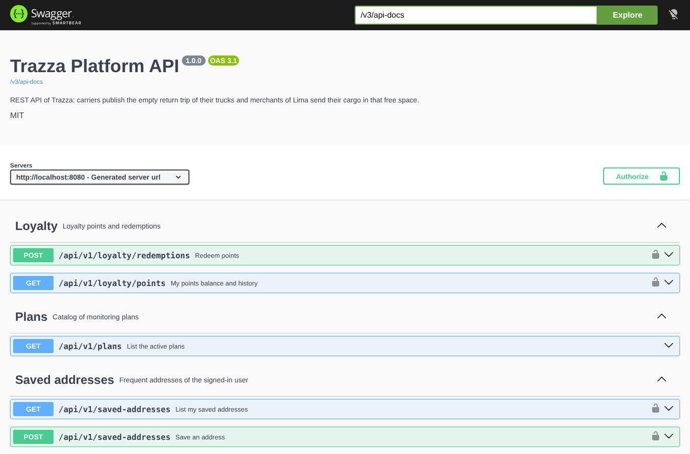
    
  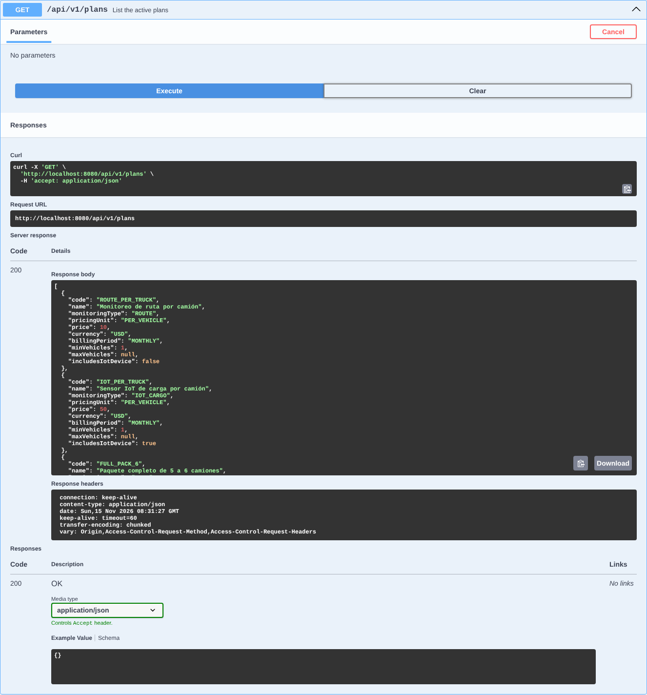
    
  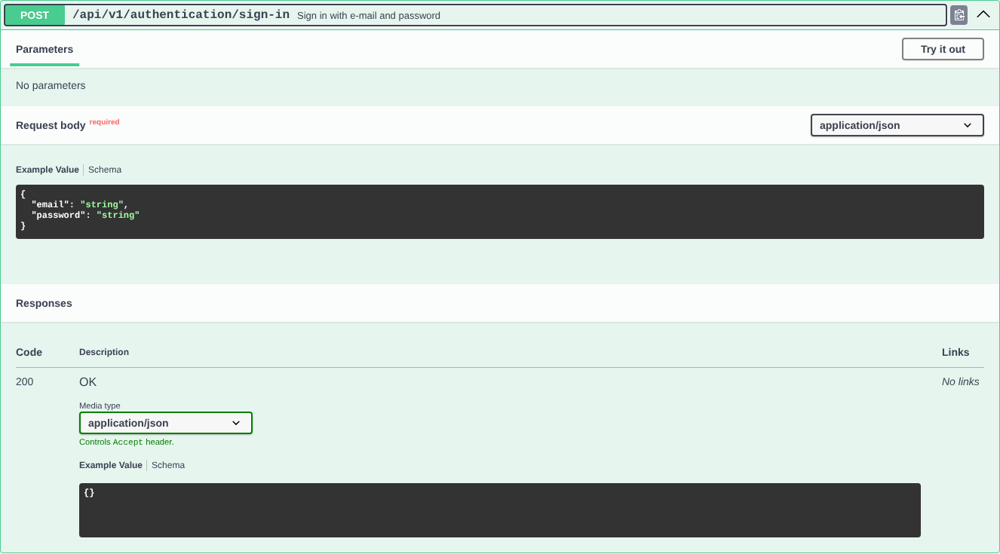

**URL del repositorio de Web Services:** [https://github.com/NexusLibre-1ASI0729-2620-16692/webservice](https://github.com/NexusLibre-1ASI0729-2620-16692/webservice)

**Commits relacionados con la documentación:** `8cab0ed` (build: add springdoc openapi dependency) y `f5e7d5b` (feat(shared): add OpenApiConfiguration).

#### 5.2.3.7. Software Deployment Evidence for Sprint Review

En el Sprint 3 se desplegaron los tres productos de Trazza en una cuenta de AWS en la región us-east-1:

- **Base de datos:** se creó la base de datos `trazza_java` en una instancia de Amazon RDS for MySQL, con un usuario de aplicación que solo tiene permisos sobre esa base. El esquema se cargó con un script SQL. Las credenciales y las claves del backend se guardaron en AWS Systems Manager Parameter Store, fuera del repositorio.
- **Web Services:** el backend se empaquetó como un archivo `.jar` con Spring Boot y se ejecuta en una instancia de Amazon EC2 (`trazza-api`), administrada mediante AWS Systems Manager sin abrir acceso por SSH. Delante de la instancia se configuró una distribución de Amazon CloudFront, que publica la API por HTTPS.
- **Web Application:** se compiló la versión `v1.2.0` con la URL de la nueva API y se publicó en AWS Amplify Hosting mediante despliegue manual.
- **Landing Page:** se publicó en AWS Amplify Hosting y sus botones de registro e inicio de sesión llevan a la Web Application.

Todos los recursos llevan la etiqueta `Project=trazza-java` para identificarlos dentro de la cuenta.

| Software Component | Deployment Platform | Repository / Version | Deployment URL | Status |
| :--- | :--- | :--- | :--- | :--- |
| Web Services | Amazon EC2 + Amazon CloudFront + Amazon RDS for MySQL | webservice / `v1.0.1` | https://d3ffa60zhvxa6z.cloudfront.net/api/v1 | Active |
| Frontend Web App | AWS Amplify | Trazza-webApp / `v1.2.0` | https://main.d3ay7a8hqjpl0e.amplifyapp.com | Active |
| Landing Page | AWS Amplify | Trazza-landingPage / main | https://main.d2soatgf2kprn3.amplifyapp.com | Active |

#### 5.2.3.8. Team Collaboration Insights during Sprint

En el Sprint 3 el equipo trabajó en los repositorios `webservice` y `Trazza-webApp` siguiendo GitFlow. Cada bounded context se desarrolló en su propia rama `feature/*` (`feature/iam-core`, `feature/iam-profiles`, `feature/matchmaking-routing`, `feature/service-execution-monitoring`, `feature/payment-billing`, `feature/loyalty-reputation` y `feature/shared`), que luego se integró a `develop` mediante merges y Pull Requests. Desde `develop` se creó la rama `release/1.0.0` del backend, y una corrección posterior se publicó con la rama `hotfix/1.0.1`. En la semana del 8 al 15 de noviembre, el repositorio `webservice` registró 283 commits de 6 autores (sin contar merges) y 4 Pull Requests integrados.

| Team Member | GitHub Username | Repository | Commits (webservice) | Main Contribution |
| :--- | :--- | :--- | :---: | :--- |
| Checalla Apaza, Emanuel Renato | Emanuelca135 / Petalia-Cosmetica | webservice | 14 | Controladores REST de autenticación y gestión de flota del bounded context IAM. |
| Lozano Quispe, Fabricio Jofred | FabricioZz15 | webservice / Trazza-webApp | 53 | Bounded context Billing (suscripciones y planes) y traducciones del módulo de pagos en la Web Application. |
| Pezo Castilla, Maria Jose | MariaJosePezo | webservice | 64 | Bounded context Execution (viajes, seguimiento e incidentes) y sus pruebas unitarias. |
| Peñaranda Caldas, Gabriel Augusto | gapc2124 | webservice / Trazza-webApp | 130 | Bounded contexts IAM y Matchmaking, módulo `shared`, documentación OpenAPI, integración de la Web Application con la API, releases y despliegue en AWS. |
| Vite Celis, Rodrigo Matias | rodriznnn | webservice / Trazza-webApp | 26 | Bounded context Reputation (calificaciones y puntos de lealtad) y su opción en el menú de la Web Application. |

Las siguientes capturas muestran el resumen de actividad, el gráfico de ramas y las contribuciones de cada integrante en el repositorio `webservice`. Los commits de Checalla Apaza, Emanuel Renato aparecen repartidos entre sus cuentas `Petalia-Cosmetica` y `Emanuelca135`.

  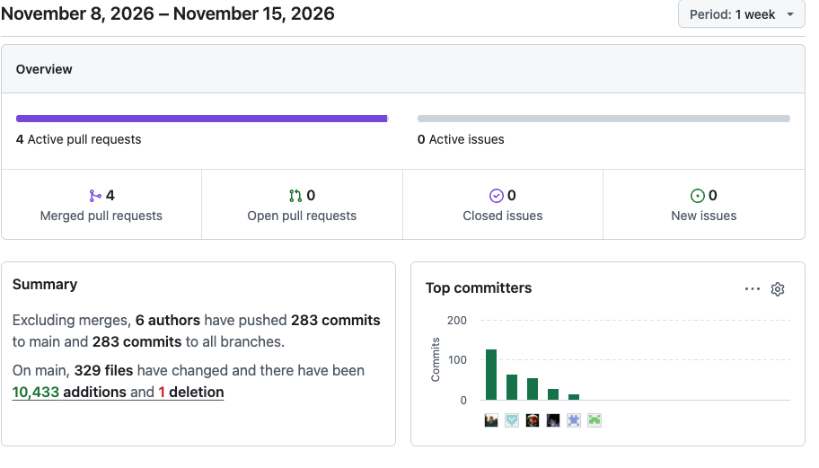
    
  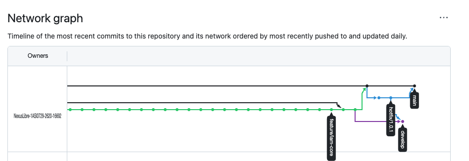
    
  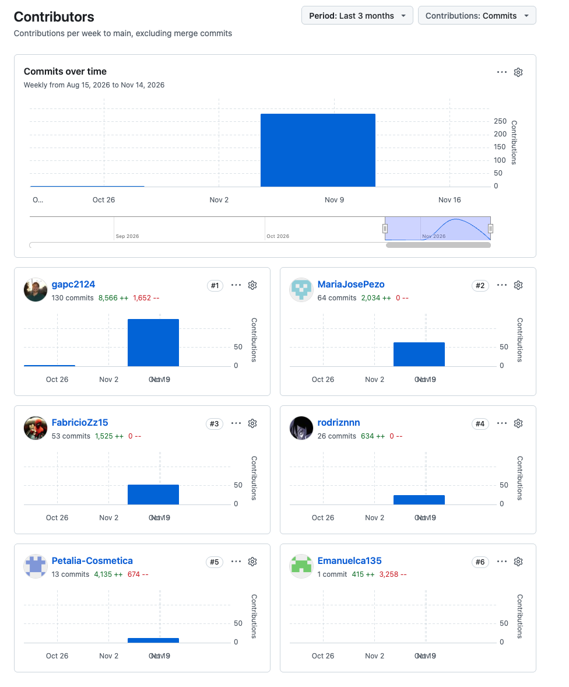

