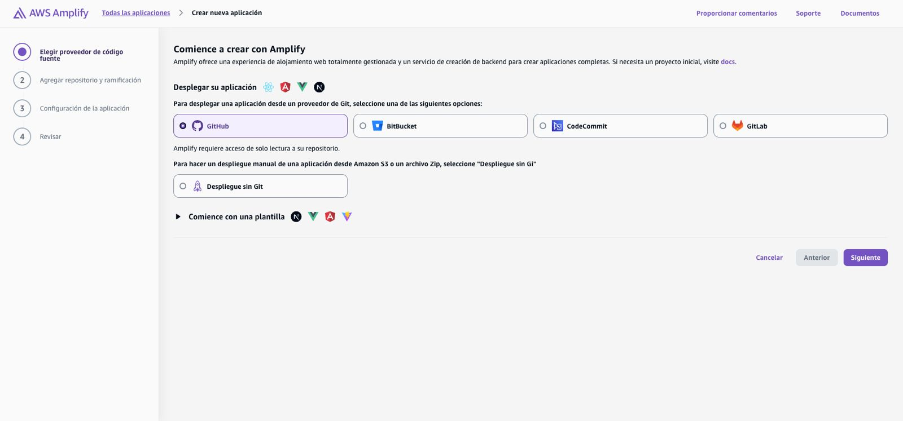

### 5.2.1. Sprint 1

En esta sección se registra el avance en producto y en trabajo colaborativo del Sprint 1, cuyo alcance fue la primera versión del Landing Page, primer punto de contacto de Trazza con transportistas y comerciantes MYPE. En paralelo, el equipo elaboró las secciones de los capítulos 1 a 4 del informe.

#### 5.2.1.1. Sprint Planning 1

En el Sprint Planning 1 el equipo definió el objetivo del Sprint y seleccionó las User Stories del Landing Page con mayor prioridad en el Product Backlog.

| Sprint # | Sprint 1 |
| :--- | :--- |
| **Sprint Planning Background** | |
| Date | 2026-09-18 |
| Time | 10:00 AM |
| Location | Reunión virtual vía Microsoft Teams |
| Prepared By | Peñaranda Caldas, Gabriel Augusto |
| Attendees (to planning meeting) | Checalla Apaza, Emanuel Renato / Lozano Quispe, Fabricio Jofred / Pezo Castilla, Maria Jose / Peñaranda Caldas, Gabriel Augusto / Vite Celis, Rodrigo Matias |
| Sprint 0 Review Summary | N/A. Es el primer Sprint del proyecto. |
| Sprint 0 Retrospective Summary | N/A. Es el primer Sprint del proyecto. |
| **Sprint Goal & User Stories** | |
| Sprint 1 Goal | **Nuestro enfoque está en** publicar la primera versión del Landing Page de Trazza para sus dos segmentos objetivo. **Creemos que esto entrega** una razón clara para registrarse **a** los transportistas independientes con viajes de retorno vacíos y a los comerciantes MYPE que envían mercadería dentro de Lima Metropolitana. **Esto se confirmará cuando** el Landing Page esté disponible en una URL pública con HTTPS, las 3 historias comprometidas (US04, US05 y US25, **6 de 6 SP**) estén cerradas con el 100 % de sus criterios de aceptación cumplidos, y los accesos de registro de cada rol estén visibles en la sección principal. |
| Sprint 1 Velocity | 6 Story Points |
| Sum of Story Points | 6 Story Points (US04: 2, US05: 2, US25: 2) |

#### 5.2.1.2. Aspect Leaders and Collaborators

Los aspectos del Sprint 1 son la implementación del Landing Page, el diseño de sus wireframes y mock-ups (sección 4.3) y su despliegue. Los líderes se asignaron según la participación registrada en los repositorios, con un líder por aspecto.

| Team Member (Last Name, First Name) | GitHub Username | Landing Page Implementation (L/C) | Landing Page UI Design (L/C) | Landing Page Deployment (L/C) |
| :--- | :--- | :---: | :---: | :---: |
| Checalla Apaza, Emanuel Renato | Emanuelca135 | C | C | L |
| Lozano Quispe, Fabricio Jofred | FabricioZz15 | C | L | C |
| Peñaranda Caldas, Gabriel Augusto | gapc2124 | L | C | C |
| Pezo Castilla, Maria Jose | MariaJosePezo | C | C | C |
| Vite Celis, Rodrigo Matias | rodriznnn | C | C | C |

#### 5.2.1.3. Sprint Backlog 1

El objetivo del Sprint 1 fue publicar la primera versión del Landing Page. Las User Stories se descompusieron en tareas de 4 a 8 horas. Al cierre del Sprint, 6 tareas: 6 en **Done**, 0 en **In-Process**, 0 en **To-Review** y 0 en **To-do**.

**URL público del Board:** [https://trazza.atlassian.net/jira/software/projects/SCRUM/boards/1/backlog](https://trazza.atlassian.net/jira/software/projects/SCRUM/boards/1/backlog)

| Sprint # | Sprint 1 | | | | | | |
| :--- | :--- | :--- | :--- | :--- | :--- | :--- | :--- |
| **User Story** | | **Work-Item / Task** | | | | | |
| **Id** | **Title** | **Id** | **Title** | **Description** | **Estimation (Hours)** | **Assigned To** | **Status (To-do / In-Process / To-Review / Done)** |
| US04 | Landing Page: Propuesta para Transportistas | T01 | Estructura base del repositorio | Crear el repositorio del Landing Page (hoy `trazza-website`) y la estructura inicial del sitio. | 4 | Pezo Castilla, Maria Jose | Done |
| US04 | Landing Page: Propuesta para Transportistas | T02 | Header, navegación y Hero | Implementar la barra de navegación responsive y la sección Hero con los botones por rol. | 6 | Peñaranda Caldas, Gabriel Augusto | Done |
| US04 | Landing Page: Propuesta para Transportistas | T03 | Sección para transportistas | Maquetar los beneficios para el transportista y el llamado a registrarse. | 4 | Peñaranda Caldas, Gabriel Augusto | Done |
| US05 | Landing Page: Propuesta para Emprendedores | T04 | Sección para comerciantes y comparativa | Maquetar los beneficios para el comerciante MYPE y la comparativa frente al flete tradicional. | 5 | Peñaranda Caldas, Gabriel Augusto | Done |
| US25 | Landing Page: Testimonios de Éxito | T05 | Testimonios y footer | Implementar las tarjetas de testimonios, la sección de contacto y el footer. | 4 | Peñaranda Caldas, Gabriel Augusto | Done |
| — | Constraint | T06 | Despliegue en AWS Amplify | Conectar el repositorio con AWS Amplify, publicar la rama `main` y validar la URL pública. | 4 | Checalla Apaza, Emanuel Renato | Done |

#### 5.2.1.4. Development Evidence for Sprint Review

En el Sprint 1 se creó el repositorio del Landing Page y se implementó su primera versión, que luego se publicó en AWS Amplify. En paralelo se documentaron en el informe los capítulos 1 a 4. El repositorio del Landing Page se recreó el 2026-09-18 y la historia del repositorio anterior no se conserva; el historial actual de `trazza-website` empieza el 2026-10-07, por lo que los commits del Landing Page de este Sprint no figuran en la tabla. La tabla muestra los 48 commits sin merge del repositorio del informe entre el 2026-09-08 y el 2026-10-04.

| Repository | Branch | Commit Id | Commit Message | Commit Message Body | Committed on (Date) |
| :--- | :--- | :--- | :--- | :--- | :--- |
| NexusLibre-1ASI0729-2620-16692/trazza-report | main | 178a298 | docs(informe): crear archivos base markdown para los capitulos | - | 2026-09-08 |
| NexusLibre-1ASI0729-2620-16692/trazza-report | feature/21-competidores | fa02de9 | docs(introduction): agregar introduction.md y estructurar carpeta de recursos | - | 2026-09-08 |
| NexusLibre-1ASI0729-2620-16692/trazza-report | feature/21-competidores | 8bca497 | docs(chapter1): estructurar seccion 1.1 startup profile con matriz de integrantes | - | 2026-09-08 |
| NexusLibre-1ASI0729-2620-16692/trazza-report | feature/21-competidores | f400eae | docs(chapter1): format team profile table and add missing sections | - | 2026-09-08 |
| NexusLibre-1ASI0729-2620-16692/trazza-report | feature/21-competidores | a7f77c1 | feat(chapter1): add antecedentes, problematica and propuesta solucion | - | 2026-09-08 |
| NexusLibre-1ASI0729-2620-16692/trazza-report | feature/21-competidores | c7ac7a4 | doc: adding personal information in chapter1 and my perfil photo | - | 2026-09-09 |
| NexusLibre-1ASI0729-2620-16692/trazza-report | feature/21-competidores | cf77dd5 | docs: add personal profile photo | - | 2026-09-09 |
| NexusLibre-1ASI0729-2620-16692/trazza-report | feature/21-competidores | 644050b | doc: adding personal information in chapter1 and my perfil photo | - | 2026-09-09 |
| NexusLibre-1ASI0729-2620-16692/trazza-report | feature/21-competidores | 5434118 | doc: Lean UX problem Statement, Assu,ptions and Hypothesis, done | - | 2026-09-10 |
| NexusLibre-1ASI0729-2620-16692/trazza-report | feature/21-competidores | 9939fbc | docs(chapter1): finishin 1.2.2 section with Lean UX Canvas | - | 2026-09-10 |
| NexusLibre-1ASI0729-2620-16692/trazza-report | feature/21-competidores | a9337aa | docs(chapter1): finishing 1.3 with 2 target segments | - | 2026-09-10 |
| NexusLibre-1ASI0729-2620-16692/trazza-report | feature/21-competidores | 56643c5 | docs: add personal profile photo | - | 2026-09-10 |
| NexusLibre-1ASI0729-2620-16692/trazza-report | feature/21-competidores | 6b41f8b | doc: adding personal information in chapter1 and my perfil photo | - | 2026-09-10 |
| NexusLibre-1ASI0729-2620-16692/trazza-report | feature/21-competidores | 617b999 | docs: Create chapter2 folder to images | - | 2026-09-10 |
| NexusLibre-1ASI0729-2620-16692/trazza-report | feature/21-competidores | 409c355 | Delete assets/images/chapter2 | - | 2026-09-10 |
| NexusLibre-1ASI0729-2620-16692/trazza-report | feature/21-competidores | df32eb1 | docs(chapter2): add competitor logos for competitive analysis. | - | 2026-09-10 |
| NexusLibre-1ASI0729-2620-16692/trazza-report | feature/21-competidores | b96f6b2 | Add .gitkeep to chapter2 directory | - | 2026-09-10 |
| NexusLibre-1ASI0729-2620-16692/trazza-report | feature/21-competidores | 945ee46 | Delete assets/images/logo-FleteRetorno.jpeg | - | 2026-09-10 |
| NexusLibre-1ASI0729-2620-16692/trazza-report | feature/21-competidores | 338af2d | Delete assets/images/logo-cargaYa.jpeg | - | 2026-09-10 |
| NexusLibre-1ASI0729-2620-16692/trazza-report | feature/21-competidores | 9b8a647 | Delete assets/images/logo-micarga.jpeg | - | 2026-09-10 |
| NexusLibre-1ASI0729-2620-16692/trazza-report | feature/21-competidores | f6fcf77 | docs(chapter2): add competitor logos for competitive analysis | - | 2026-09-10 |
| NexusLibre-1ASI0729-2620-16692/trazza-report | feature/21-competidores | a36a75c | Delete assets/images/chapter2/.gitkeep | - | 2026-09-10 |
| NexusLibre-1ASI0729-2620-16692/trazza-report | feature/21-competidores | 6df055a | docs(chapter2): add trazza logo for competitive analysis | - | 2026-09-10 |
| NexusLibre-1ASI0729-2620-16692/trazza-report | feature/21-competidores | ca0343b | docs(chapter2): add competitive analysis for trazza in chapter II | - | 2026-09-10 |
| NexusLibre-1ASI0729-2620-16692/trazza-report | feature/21-competidores | 9f86a99 | docs(chapter2): add strategies and tactics against competitors in chapter II | - | 2026-09-10 |
| NexusLibre-1ASI0729-2620-16692/trazza-report | feature/21-competidores | 763ca12 | docs(chapter2): add interview design in chapter II | Expanded the competitive analysis section, detailing Trazza's positioning against competitors and strategies for market entry. Added interview design and questions for transporters and small-medium entrepreneurs. | 2026-09-10 |
| NexusLibre-1ASI0729-2620-16692/trazza-report | feature/21-competidores | d90d6e1 | docs: add interview 3 details and video link in chapter 2 | - | 2026-09-12 |
| NexusLibre-1ASI0729-2620-16692/trazza-report | feature/21-competidores | 3af2e16 | docs: add screenshot for interview 3 in chapter 2 | - | 2026-09-12 |
| NexusLibre-1ASI0729-2620-16692/trazza-report | feature/21-competidores | ad9a35b | docs: add interview 3 photo and finalize details | - | 2026-09-12 |
| NexusLibre-1ASI0729-2620-16692/trazza-report | feature/21-competidores | 1019c96 | docs(chapter2): add details of the second interview and the summary in chapter II | - | 2026-09-12 |
| NexusLibre-1ASI0729-2620-16692/trazza-report | feature/21-competidores | a8a003a | docs(chapter2): updated summary interviews | - | 2026-09-12 |
| NexusLibre-1ASI0729-2620-16692/trazza-report | feature/21-competidores | 3278953 | doc(front-matter): applying docs-as-code principles and improving the front matter | - | 2026-09-13 |
| NexusLibre-1ASI0729-2620-16692/trazza-report | feature/21-competidores | 6d4a322 | doc(student-outcome) I've set up a template for the student outcome. | - | 2026-09-13 |
| NexusLibre-1ASI0729-2620-16692/trazza-report | feature/21-competidores | 636d88f | doc(chapter1): changin the structure of chapter1 | - | 2026-09-13 |
| NexusLibre-1ASI0729-2620-16692/trazza-report | feature/21-competidores | 93d91c0 | doc(Lean UX Process) Problem Statements, Assumptions and Hypothesis Statements updated | - | 2026-09-13 |
| NexusLibre-1ASI0729-2620-16692/trazza-report | feature/21-competidores | df16671 | fix(solution profile): fixing some errors | - | 2026-09-13 |
| NexusLibre-1ASI0729-2620-16692/trazza-report | feature/21-competidores | cc80ee3 | doc(chapter2): adding docs | - | 2026-09-13 |
| NexusLibre-1ASI0729-2620-16692/trazza-report | feature/24-event-storming | 9c2220b | feat: add personal profile photo | - | 2026-09-13 |
| NexusLibre-1ASI0729-2620-16692/trazza-report | feature/24-event-storming | 7b8553e | feat: add personal profile photo | - | 2026-09-13 |
| NexusLibre-1ASI0729-2620-16692/trazza-report | feature/24-event-storming | 0d1f379 | feat: add personal profile photo | - | 2026-09-13 |
| NexusLibre-1ASI0729-2620-16692/trazza-report | feature/24-event-storming | 08c4e3f | feat: add personal profile photo | - | 2026-09-13 |
| NexusLibre-1ASI0729-2620-16692/trazza-report | feature/24-event-storming | 8e5c564 | feat: add personal profile | - | 2026-09-14 |
| NexusLibre-1ASI0729-2620-16692/trazza-report | feature/25-ubiquitous-language | 8ad6825 | feat: add user personas | - | 2026-09-15 |
| NexusLibre-1ASI0729-2620-16692/trazza-report | feature/25-ubiquitous-language | b888d5f | feat: add needfinding | - | 2026-09-15 |
| NexusLibre-1ASI0729-2620-16692/trazza-report | feature/25-ubiquitous-language | fbf166e | feat: partially completing the needfinding | - | 2026-09-15 |
| NexusLibre-1ASI0729-2620-16692/trazza-report | feature/25-ubiquitous-language | 8fecb1e | feat: update needfinding | - | 2026-09-15 |
| NexusLibre-1ASI0729-2620-16692/trazza-report | feature/25-ubiquitous-language | 5e3d58e | doc(ubiquitous language): migrating the progress from the stackroot repository | - | 2026-09-15 |
| NexusLibre-1ASI0729-2620-16692/trazza-report | feature/add-participation-information | 98c1b28 | feat: add participation information | - | 2026-09-18 |

#### 5.2.1.5. Execution Evidence for Sprint Review

Al cierre del Sprint 1, el Landing Page quedó publicado en una URL pública. Presentaba la propuesta de valor para ambos segmentos, la comparativa frente al flete tradicional, los testimonios y los accesos al registro por rol.

| Evidencia | Archivo esperado | Estado |
| :--- | :--- | :--- |
| Landing Page v1, vista de escritorio | chapter5/sprint1-landing-desktop.png | Pendiente |
| Landing Page v1, vista móvil | chapter5/sprint1-landing-mobile.png | Pendiente |

Las capturas que existían del Landing Page v1 se retiraron porque muestran un dominio de despliegue y una organización de GitHub (`StackRoot-1ASI0730-2620-8084`) distintos de los de este proyecto; se reemplazarán por capturas del despliegue de `NexusLibre-1ASI0729-2620-16692`.

**Video de navegación del Sprint 1:** [upc-pre-202620-1asi0729-16692-NexusLibre-productnavigation-sprint-1.mp4](https://upcedupe-my.sharepoint.com/:v:/g/personal/u202414356_upc_edu_pe/IQAHwNmBh-BrSIywebxTh1XRAXSQ67CxwXjsw4F17WnJ3nQ?e=dc5eL3&nav=eyJyZWZlcnJhbEluZm8iOnsicmVmZXJyYWxBcHAiOiJTdHJlYW1XZWJBcHAiLCJyZWZlcnJhbFZpZXciOiJTaGFyZURpYWxvZy1MaW5rIiwicmVmZXJyYWxBcHBQbGF0Zm9ybSI6IldlYiIsInJlZmVycmFsTW9kZSI6InZpZXcifX0%3D)

#### 5.2.1.6. Services Documentation Evidence for Sprint Review

El alcance del Sprint 1 se limitó al Landing Page, que es un sitio estático. Por ello, en este Sprint no se implementaron ni documentaron endpoints con OpenAPI. Los Web Services de Trazza se implementaron en Spring Boot en el Sprint 3 y su documentación se presenta en la sección 5.2.3.6.

#### 5.2.1.7. Software Deployment Evidence for Sprint Review

En el Sprint 1 se creó la aplicación en AWS Amplify Hosting y se conectó con la rama `main` del repositorio del Landing Page, siguiendo los pasos descritos en la sección 5.1.4. Al ser un sitio estático, no requiere comando de build. Desde entonces, cada cambio integrado en `main` se publica automáticamente.

| Producto | Plataforma | URL publicada | Estado al 2026-11-26 |
| :--- | :--- | :--- | :--- |
| Landing Page | AWS Amplify Hosting | https://main.dop9j8vefsnfj.amplifyapp.com | El dominio no resuelve en DNS; se vuelve a publicar en el Sprint 4 (TS07) |

  

#### 5.2.1.8. Team Collaboration Insights during Sprint

En el Sprint 1 el trabajo del equipo se concentró en el repositorio del informe, donde cada sección se trabajó en una rama `feature/<número>-<nombre>` y se integró a `develop` mediante Pull Requests. La siguiente tabla cuenta los commits sin merge entre el 2026-09-08 y el 2026-10-04. El historial del Landing Page de este Sprint no se conserva (sección 5.2.1.4).

| Integrante | GitHub Username | trazza-report | trazza-website | trazza-webapp | trazza-webservice | Total |
| :--- | :--- | :---: | :---: | :---: | :---: | :---: |
| Checalla Apaza, Emanuel Renato | Emanuelca135 | 0 | 0 | 0 | 0 | 0 |
| Lozano Quispe, Fabricio Jofred | FabricioZz15 | 17 | 0 | 0 | 0 | 17 |
| Peñaranda Caldas, Gabriel Augusto | gapc2124 | 16 | 0 | 0 | 0 | 16 |
| Pezo Castilla, Maria Jose | MariaJosePezo | 10 | 0 | 0 | 0 | 10 |
| Vite Celis, Rodrigo Matias | rodriznnn | 5 | 0 | 0 | 0 | 5 |
| **Total** |  | **48** | **0** | **0** | **0** | **48** |

  
    
  

